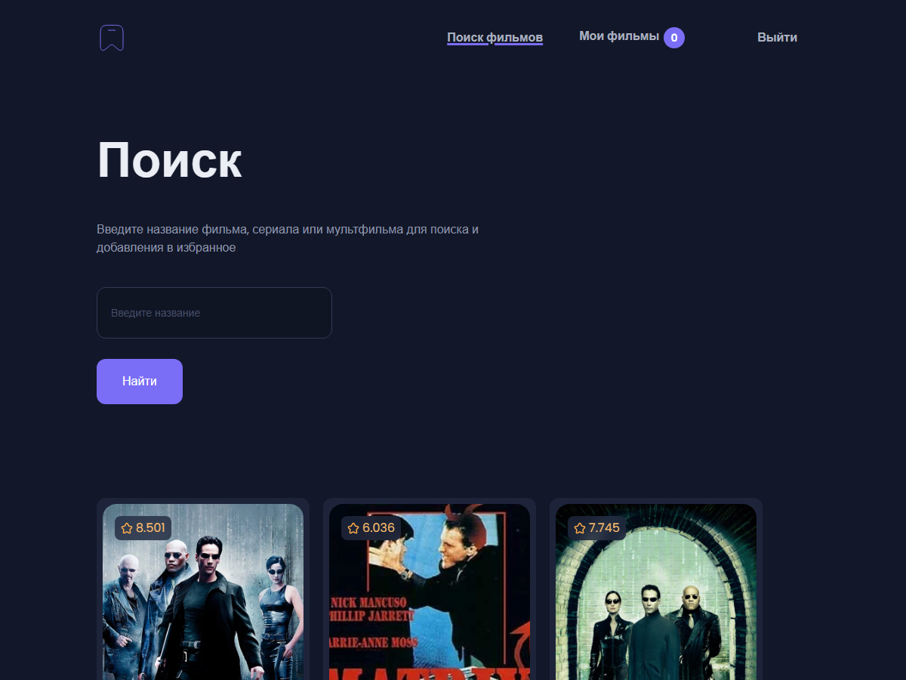
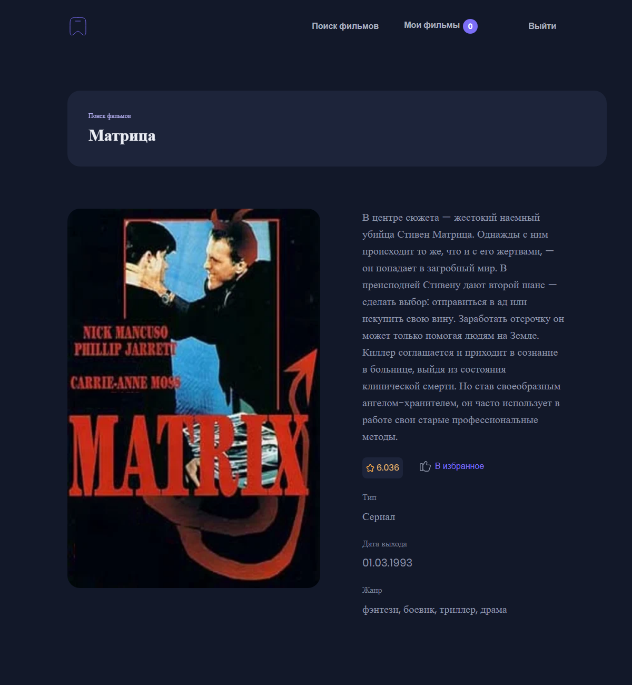
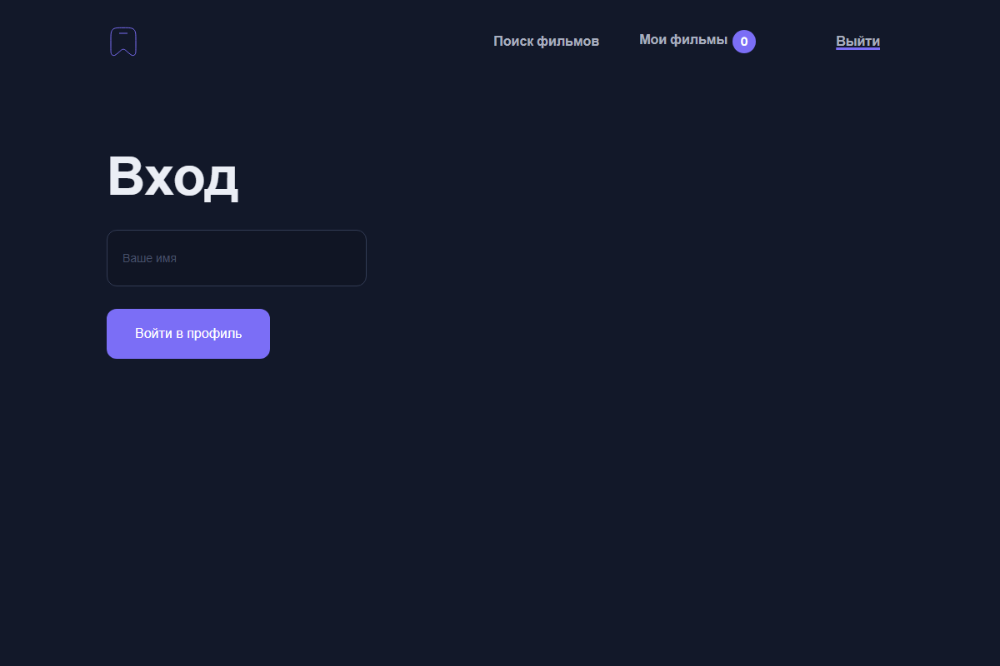

# Кинотеатр — поиск фильмов

SPA для поиска фильмов и сериалов: поиск по названию, карточка фильма с описанием и рейтингом, избранное и вход по имени.

**Демо:** <https://nothingvrs.github.io/kinoteatr/>

| Поиск | Карточка фильма | Вход |
| --- | --- | --- |
|  |  |  |

## Стек

- React 18, TypeScript
- Redux Toolkit (избранное, профиль), react-redux
- React Router 6 (HashRouter — работает на статическом хостинге без настройки сервера)
- axios, Vite 5, ESLint

## Возможности

- Вход по имени (профиль хранится в localStorage)
- Поиск фильмов, сериалов и мультфильмов по названию
- Карточка фильма: постер, описание, рейтинг Кинопоиска, тип, дата выхода, жанры
- Избранное: добавление/удаление карточек, счётчик в меню, страница «Мои фильмы»

## API

Данные — [ПоискКино API](https://api.poiskkino.dev/documentation) (`api.poiskkino.dev/v1.5`): поиск `/movie/search`, детали `/movie/{id}`. Авторизация — заголовок `X-API-KEY` (тестовый ключ с лимитом 200 запросов в сутки). Слой доступа и маппинг полей — [`src/api.ts`](src/api.ts).

## Структура

```
src/
  api.ts            запросы к ПоискКино и маппинг в модель карточки
  main.tsx          роутер (HashRouter) и загрузчик страницы фильма
  pages/            Search, Description, Favourite, Enter, SearchError
  components/       FilmCard, FilmDesc, Form, Input, Menu, Headling...
  store/            Redux Toolkit: профиль и избранное (+ localStorage)
  layouts/          Layout, LoginLayout, header
```

## Запуск

Нужен Node 18+.

```bash
npm install
npm run dev      # dev-сервер Vite
npm run build    # сборка в dist/ (tsc + vite)
npm run lint
```

## Деплой

При пуше в `master` GitHub Actions собирает проект и публикует `dist/` на GitHub Pages ([`.github/workflows/deploy.yml`](.github/workflows/deploy.yml)).

## Проект

Учебный проект по React (HTML Academy), переработан под API «ПоискКино».
Автор: [Роман Верещагин](https://github.com/Nothingvrs).
